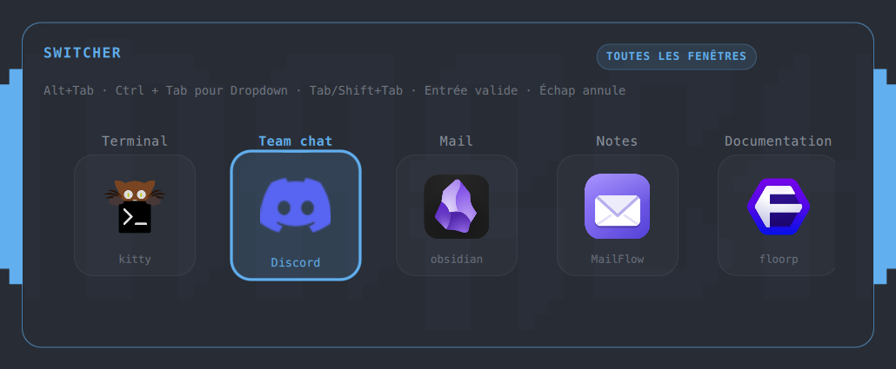
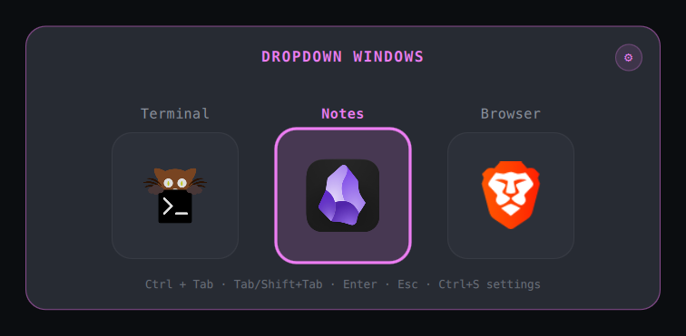
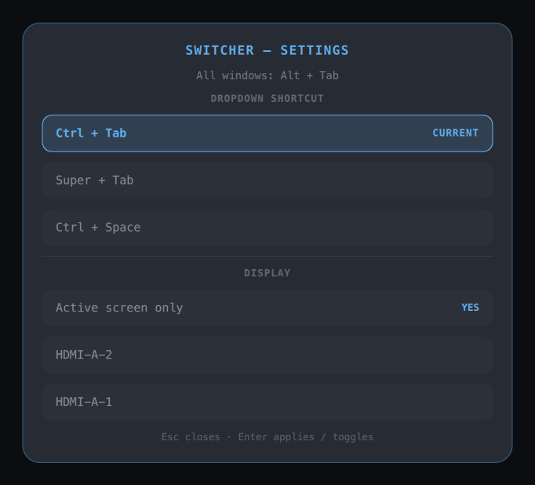

# Omarchy Switcher

A keyboard-first window switcher for [Omarchy](https://omarchy.org), built to
work directly with [Dropdown](https://github.com/ApachaiZ/omarchy-dropdown).


- **Alt + Tab** (configurable) cycles mapped applications that Dropdown does
  **not** manage, one card per app.
- **Ctrl + Tab** cycles only applications managed by Dropdown.
- Binds are registered at runtime; no files outside the plugin folder.
- A central overlay with a translucent, blurred backdrop.
- One icon card per **application**, with a centered stylized title above it.
- Applications with several windows show a chevron and window count below the
  card; `↓` (or a click on the chevron) opens the list of their windows.
- Each card and each window row shows the monitor and workspace where the
  window lives (`HDMI-A-1 · 3`). Parked Dropdown windows are labelled
  `Dropdown`.
- The selected card zooms and takes the mode's accent colour.
- The all-windows mode uses the active theme accent; **Dropdown** mode rotates
  that accent toward violet, so the two contexts are immediately
  distinguishable.
- **Settings**: `Alt+S` / `Ctrl+S` inside the overlay (the modifier follows the
  mode), or the ⚙ button. There is no global settings shortcut, so the
  switcher never takes a key from the rest of the desktop.
- No screen capture. Icons are local; titles are rendered as plain text.


## Screenshots

| Windows | Dropdown windows |
| --- | --- |
|  |  |



> The screenshots predate 0.3: cards are now grouped by application, show the
> monitor/workspace badge and can expand a window list. They will be
> regenerated before the release.

## Install

```bash
omarchy plugin add https://github.com/ApachaiZ/omarchy-switcher --enable --yes
```

That is the whole install. The service registers its Hyprland shortcuts and
layer rule itself when the shell loads it, and re-registers them after every
Hyprland config reload. The plugin needs no files outside
`~/.config/omarchy/plugins/apach.switcher/`; the settings panel only stores
your choices in `~/.config/omarchy/switcher.json`.

### Requirements

- Omarchy 4 (the Quickshell shell) with Hyprland's Lua config: runtime bindings
  use `hyprctl eval`.
- Dropdown is optional; only the Dropdown mode needs it.
- No Node, build step or extra package is needed. Node is only used by the
  development test suite.

If you are migrating from 0.1.x, delete `~/.config/hypr/switcher.lua` and the
`require("hypr.switcher")` line from `hyprland.lua`, then reload Hyprland.
Until you do, the service keeps honouring that file for compatibility.

The default bindings are:

| Shortcut | Action |
| --- | --- |
| `Alt + Tab` | cycle other applications |
| `Alt + Shift + Tab` | cycle other applications backwards |
| `Ctrl + Tab` | cycle Dropdown applications |
| `Ctrl + Shift + Tab` | cycle Dropdown applications backwards |

The all-windows shortcut can also be set to Alt + backtick (reverse
Alt + Shift + backtick) in Settings. `Super + Tab` is deliberately not offered:
Omarchy uses it for workspace switching.

### Omarchy plugin contract

This repository is a standard Omarchy shell plugin:

- `manifest.json` uses `schemaVersion: 1`, `kinds: ["service"]`,
  `keepLoaded: true` and `entryPoints.service = "Service.qml"`;
- `omarchy plugin validate .` passes, the id is outside the reserved
  `omarchy.*` namespace, and the folder contains no symlinks;
- there is **no install hook**. `omarchy plugin add` only clones, validates and
  enables; the `scripts/` helpers are developer tools that Omarchy never runs;
- the plugin needs no sudo, no package installation and no network access;
- all installed files stay inside
  `~/.config/omarchy/plugins/apach.switcher/`.

Like every Omarchy plugin, it runs as unsandboxed code inside `omarchy-shell`.
Only install it if you trust the repository. The plugin writes only its own
settings file (`~/.config/omarchy/switcher.json`). A 0.1.x static file is still
read for compatibility until you remove it.

### How runtime bindings behave

- Hyprland drops binds and layer rules registered with `hyprctl eval` on every
  config reload. The service re-applies them on Hyprland's `configreloaded`
  event, so for a few milliseconds after a reload the all-windows shortcut
  belongs to Omarchy's default binds again.
- After registering, the service compares `hyprctl binds -j` with the chords it
  expects and retries once if a bind did not land. Registration errors are
  reported in the settings panel and in `diagnose`.
- Changes are coalesced and deduplicated: one `hyprctl eval` at a time, and no
  process is spawned when the bind-relevant settings did not change.
- When `omarchy-shell` stops or restarts, the service reloads Hyprland's
  config (`hyprctl reload config-only`). That removes the runtime binds and
  restores Omarchy's own shortcuts, so the desktop keeps working while the
  shell is down; the next shell start registers the switcher again. A 0.1.x
  static file, if still present, keeps its binds, but their IPC calls still
  need the service.
- If the shell is killed abruptly, its destruction handler cannot run: the
  binds stay but their IPC calls fail until the next config reload.
- Disabling the plugin runs the same config reload, so no dead shortcut is
  left behind.
- Conflicts are reported, not resolved silently: if another tool (for example
  `vbrosseau.alttab`) owns one of the chords, the settings panel names it.

### Updating and removing

```bash
omarchy plugin update apach.switcher --yes
omarchy restart shell   # keepLoaded services keep their old code until a restart
```

The service is declared `keepLoaded: true`, so file updates alone do not
replace the running instance. When migrating from 0.1.x, remove the old static
file and its `require` line first, then reload Hyprland and remove the plugin:

```bash
rm -f ~/.config/hypr/switcher.lua
# remove require("hypr.switcher") from ~/.config/hypr/hyprland.lua
hyprctl reload
omarchy plugin remove apach.switcher --yes
```

## Use

While the overlay is open:

- `Tab` / `Shift+Tab` or `←` / `→` move the selection between applications;
- `↓` opens the window list of an application that has several windows;
  `↑` / `↓` move inside it, and `↑` on the first row closes it again;
- `Ctrl+Tab` switches the current overlay to Dropdown windows;
- the all-windows shortcut switches it back to other windows;
- `Enter` or `Space` activates the selected window;
- `Escape` closes the window list first, then the switcher;
- releasing Alt (all mode) or Ctrl (Dropdown mode) activates the selection;
- clicking a card activates its most recent window, clicking a window row
  activates that window, and clicking outside cancels.

A quick tap works too: if the modifier is released before the overlay maps, the
service checks the live modifier state and commits the initial selection.

## Settings and screens

Open the settings with the **⚙** button in the overlay, with **Alt+S** in the
all-windows mode, or with **Ctrl+S** in Dropdown mode (or **Super+S** if you
chose the Super+Tab preset). With the switcher closed there is no global
settings shortcut: open the overlay first.

The display section lets you choose between:

- **Active screen only** (on by default): the overlay follows the focused
  monitor;
- a **list of detected screens with a toggle each**: pick one or several
  monitors; the overlay is mirrored only on those screens. With **Active
  screen only** off it is intentionally not shown on the focused monitor
  unless that monitor is part of the selection, so a secondary-screen mirror
  stays a secondary-screen mirror. Keyboard control remains on the focused
  monitor in that case: a transparent input surface takes the keys there, so
  arrows and Tab never reach the window underneath.

Toggle rows with `Enter` or the mouse. The screen names come from Quickshell
and are validated before being stored. `Ctrl+Tab` is only bound when the
**Dropdown plugin is enabled**; if Dropdown is absent or disabled, the
shortcut is left to the rest of the desktop and the hint omits it.

Choose the all-windows shortcut and the Dropdown shortcut from the keyboard
(`↑`/`↓`, `Enter`) or with the mouse:

- all windows: `Alt + Tab` (default) or Alt + backtick;
- Dropdown: `Ctrl + Tab` (default), `Super + Tab`, or `Ctrl + Space`.

Both choices are written to `~/.config/omarchy/switcher.json` and applied
immediately: runtime bindings are re-registered in place, with no Hyprland
reload. If a leftover 0.1.x static file is present, it is regenerated and
Hyprland reloaded. A shortcut cannot be used for both modes: choosing a
colliding value moves the Dropdown mode back to `Ctrl + Tab`.

The settings panel also reports the active binding mode (runtime or static
file), any registration error, and shortcuts that another tool already owns
on the same chords.

## Dropdown integration

The service reads Dropdown's state file only:

```
~/.local/state/omarchy/dropdown-state.json
```

It validates every address and app id before using it. Dropdown windows are
displayed with their real window title and app icon. A parked Dropdown window
is restored through Dropdown's own IPC (`omarchy-shell -q apach.dropdown
showApp <id>`), so its workspace, geometry and `dropdown-hidden` tag lifecycle
stay consistent. Non-Dropdown windows are focused by validated hex address.

Dropdown is not required: with it absent, the plugin still switches all
windows, and the Dropdown mode simply shows an empty-state message.

## Compatibility with `vbrosseau.alttab`

Do not enable both switchers at once: they compete for the same `Alt+Tab`
binding and both grab the keyboard exclusively. Disable the old plugin before
enabling Switcher.

## Security and privacy

- No network access, no screen capture, no window thumbnails.
- Window titles are rendered with `Text.PlainText`; markup or image tags in a
  title are displayed literally and never fetched.
- Icons come only from `DesktopEntries` and `Quickshell.iconPath`; icon names
  are restricted to desktop-entry syntax and `Image.source` accepts only local
  paths, `file://` or `image://`. No title, class or path is used as a URL.
- Window addresses are validated as `0x` hex before any Hyprland dispatch.
- Dropdown app ids are validated before being passed as a separate argv
  element; no shell command is built from window data.
- The state file is read locally and is never uploaded or logged.
- The IPC `status` method exposes counts, the selected index and submenu
  state, never window titles, app ids, monitor names or workspace names.
- The IPC `diagnose` method returns binding health, mode and shortcut names
  only. It never includes window titles, app ids, screen serials or the
  contents of the settings file.
- No history, screenshots or window contents are written to disk.
- `tests/qml-security.test.mjs` enforces plain text on every `Text`, forbids
  `ScreencopyView`, rejects shell command strings and checks that the generated
  bind expression is built only from the fixed preset table.

### Privacy and GDPR

The plugin has no network code, no telemetry, no analytics and no remote
endpoint. Everything it reads (window list, Dropdown state, settings, Hyprland
binds) stays on the machine and is processed in memory. The only persistent
data is `~/.config/omarchy/switcher.json` (shortcut and monitor choices), which
contains no personal data and is never transmitted. Removing the plugin and
that file removes everything the plugin wrote; if you used 0.1.x static
bindings, remove the old file and its `require` line too. See
[PRIVACY.md](PRIVACY.md) for the short form.

## Performance

- The client list is read with **one `hyprctl clients -j` process per open**.
  There is no polling while the switcher is closed.
- Application grouping and monitor/workspace badges are computed from that
  same single call, with no extra process.
- The window submenu is a `ListView` that exists only while expanded and
  scrolls instead of growing the overlay without bound.
- The overlay and its cards are created by a `LazyLoader` only while open and
  destroyed on close.
- No screencopy and no thumbnail cache: only app icons at 96×96, decoded
  asynchronously and cached by Qt.
- Icon lookups are memoized per app id and capped at 128 entries, so reopening
  the overlay does not walk the desktop-entry database again.
- Bind registrations are deduplicated by a settings fingerprint, and run one
  at a time; no `hyprctl` process is spawned when nothing changed.
- Animations are short opacity/scale transitions (110–140 ms) with no infinite
  animation.
- The Dropdown state file is a small `FileView` watcher; it contains only app
  ids and window addresses.

## Backdrop blur

The overlay uses a translucent dark panel and this layer rule, registered by
the service at runtime (a leftover 0.1.x static file is still honoured until
it is removed):

```lua
hl.layer_rule({ match = { namespace = "apach-switcher" }, blur = true, ignore_alpha = 0.15, no_anim = true })
```

Hyprland's blur must be enabled globally for the layer rule to take effect. If
`decoration:blur:enabled` is `false`, the panel still renders as a clean
translucent card without backdrop blur. Enable it in your Hyprland decoration
settings if you want the full glass effect.

## Diagnostics

The plugin exposes two local IPC methods:

```bash
omarchy-shell -q apach.switcher status    # open state, counts, bind health
omarchy-shell -q apach.switcher diagnose  # mode, registration, conflicts
```

`status` reports the group count, the window count, the selected index, the
expanded submenu and the bind health. `diagnose` adds the binding mode,
registration state, conflict count and shortcut names. Neither returns window
titles, app ids, monitor names or workspace names. Paste the output into a bug
report instead of screenshots of your windows.

## Development

```bash
scripts/check.sh
```

It runs the Node tests, `node --check`, shell syntax checks,
`omarchy plugin validate` when Omarchy is available, and `qmllint` on every QML
file when Qt's tooling is installed.

## License

MIT. See [LICENSE](LICENSE).
